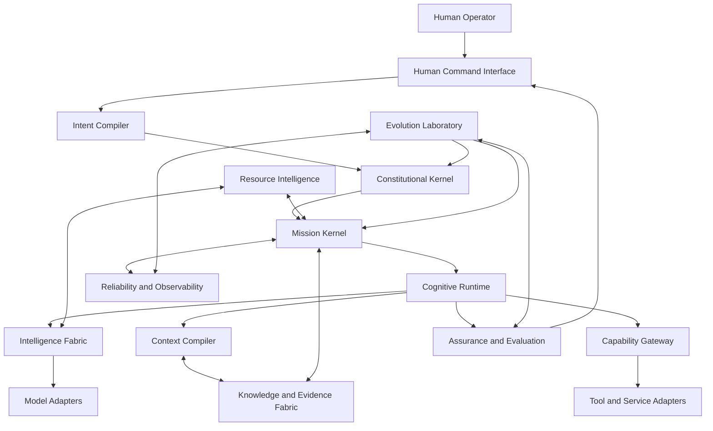
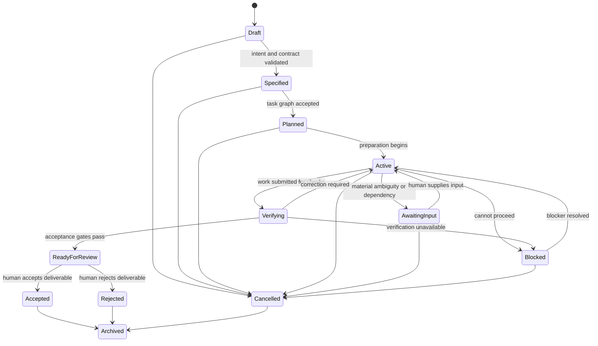

# OMEGA APEX
## Master Technical Architecture Specification

**Document ID:** OAPX-ARCH-001  
**Version:** 0.1  
**Status:** Architecture proposal for review; not an implementation or deployment instruction  
**Date:** 13 November 2026  
**Governing document:** *OMEGA APEX Supreme Constitution v1.0-draft*  
**Vision source:** *OMEGA APEX Vision, Identity, Architecture and Foundational Doctrine v0.1*  
**Initial host context:** DSH Go running in an Android-hosted PRoot Ubuntu environment  
**Autonomy mode:** PREPARE_ONLY  
**Initial economic constraint:** AI subscription spending ceiling of USD 10/month, unless explicitly revised by the human operator

---

# 0. Document conventions and normative language

This document defines the target technical architecture of OMEGA APEX. It is a design specification, not proof that the described components already exist in DSH or in any other runtime.

The key words **MUST**, **MUST NOT**, **REQUIRED**, **SHOULD**, **SHOULD NOT**, **MAY** and **OPTIONAL** are used as normative terms:

- **MUST / MUST NOT:** mandatory for a conforming OMEGA implementation.
- **SHOULD / SHOULD NOT:** strongly recommended; deviations require a documented reason.
- **MAY / OPTIONAL:** permitted but not required.

A conforming implementation must preserve the ratified Constitution. If this specification conflicts with the active Constitution, the Constitution prevails.

The design distinguishes three forms of truth:

1. **Normative requirement:** what OMEGA is required to do.
2. **Architectural proposal:** a recommended way to satisfy the requirement.
3. **Observed environment fact:** an implementation detail established through a dated inspection or test.

These forms must never be blended. A proposed interface is not an existing DSH feature. A listed plugin is not a tested integration. A historical audit result is not necessarily the current state.

---

# 1. Purpose, scope and non-goals

## 1.1 Purpose

This specification translates the OMEGA APEX vision and Supreme Constitution into a coherent technical architecture. It defines subsystem boundaries, authoritative data models, interface contracts, mission-state behavior, orchestration rules, model qualification, context assembly, memory and evidence structures, capability governance, resource accounting, verification, recovery, observability and acceptance criteria.

The target is an architecture that can be implemented incrementally on the existing DSH environment, while remaining portable to another host if that later becomes necessary.

## 1.2 In scope

This specification covers:

- Logical architecture and subsystem responsibilities.
- Trust and authority boundaries.
- Shared identifiers and versioned data contracts.
- Intent, mission, task, delegation and artifact models.
- Mission and proposed-action state machines.
- Constitutional policy decisions and approval requirements.
- Cognitive and orchestration patterns.
- Model registry, qualification and routing.
- Context construction and compaction rules.
- Memory, evidence and decision records.
- Tool and capability gateway contracts.
- Resource envelopes and subscription-aware accounting.
- Quality assurance, evaluation and regression control.
- Reliability, checkpointing, recovery and cancellation.
- Observability and operator-facing status.
- Portability, extensions and versioning.
- DSH mapping, staged qualification and acceptance gates.

## 1.3 Out of scope

This document does not yet select or mandate:

- A specific programming language.
- A specific database or vector store.
- A specific agent framework.
- A specific model provider or subscription.
- A specific DSH plugin or package version.
- A cloud provider or remote host.
- A final mobile interface implementation.
- A production deployment topology.
- Autonomous execution of consequential operations.

Those decisions belong in implementation design records after compatibility, cost and operational behavior are inspected and tested.

## 1.4 Initial product constraints

The initial design assumes:

- Hybrid purpose: personal command center plus coordinated AI workforce.
- Absolute constitutional priority within OMEGA.
- PREPARE_ONLY autonomy.
- Multi-objective performance optimization.
- A free-first approach to infrastructure.
- A maximum initial AI subscription spend of USD 10/month.
- DSH Go as the first host, not a permanent architectural dependency.
- Android as the primary user access environment.

A constraint is active only while confirmed by the human operator. The architecture must support explicit revision without silently changing historical mission records.

---

# 2. Architecture objectives and design principles

## 2.1 Mission-centered architecture

The mission is the principal unit of work. Models, agents, tools, memory, workflows and providers are resources used by a mission. OMEGA MUST NOT design its operation around an arbitrary fixed number of agents.

## 2.2 Control-plane separation

The system MUST separate deterministic control from probabilistic intelligence.

Deterministic components own:

- Constitutional version and policy evaluation.
- Permission and approval state.
- Mission and task identifiers.
- Authoritative state transitions.
- Resource ceilings.
- Tool capability authorization.
- Retry limits and circuit-breaker state.
- Event recording and outcome status.

Models may propose:

- Intent interpretations.
- Plans and task decompositions.
- Model or tool selections.
- Research questions.
- Candidate solutions.
- Draft artifacts.
- Explanations and evaluations.

Model proposals do not become authoritative facts or state changes until validated by the appropriate runtime component.

## 2.3 Modular monolith first

The initial logical architecture SHOULD be implemented as a modular system within the smallest viable host topology, rather than split immediately into many network services. Clear module contracts are more important than process separation.

A modular monolith or host-integrated set of modules can reduce operational complexity on a constrained Android/PRoot environment. Distribution may be introduced later if there is a measured need for independent scaling, isolation, availability or remote execution.

## 2.4 Complexity budget

Every subsystem, plugin, database, service, model and agent role must justify its maintenance and resource cost. Reuse an existing component only after it passes qualification. Do not retain a failing component merely because it is already installed.

## 2.5 Provider and host independence

Core mission, policy, evidence and resource contracts SHOULD be provider-neutral. Adapters translate between the stable OMEGA contracts and host-, model- or tool-specific APIs.

## 2.6 Evidence-first completion

A result is complete only when its acceptance criteria have been evaluated. The state reported by a model is a claim; the state recorded by the Mission Kernel is authoritative.

## 2.7 Explicit degradation

When a provider, tool or storage component becomes unavailable, OMEGA must preserve mission state, identify what can continue, disclose quality reductions and avoid falsely representing degraded work as equivalent.

## 2.8 Human-compatible operation

The architecture must be understandable and manageable from the operator's actual interface. It should expose meaningful mission status, approvals, results, diagnostics and resource use without requiring the operator to inspect raw agent logs for routine oversight.

---

# 3. System architecture

## 3.1 Six architectural planes

The architecture is divided into six planes. Planes are logical responsibility groupings, not mandatory deployment processes.

| Plane | Primary responsibility | Included subsystems |
|---|---|---|
| Control | Meaning, authority, mission state and approvals | Constitutional Kernel, Intent Compiler, Mission Kernel, Human Command Interface |
| Cognition | Reasoning, model use and context assembly | Cognitive Runtime, Intelligence Fabric, Context Compiler |
| Knowledge | Durable state, evidence, memory and decisions | Knowledge and Evidence Fabric |
| Capability and Resources | Tools, integrations, providers and quotas | Capability Gateway, Resource Intelligence |
| Assurance | Verification, reliability and visibility | Assurance and Evaluation, Reliability and Observability |
| Evolution | Evidence-based improvement proposals | Evolution Laboratory |

## 3.2 Thirteen logical subsystems

1. Supreme Constitutional Kernel.
2. Intent Compiler.
3. Mission Kernel.
4. Human Command Interface.
5. Cognitive Runtime.
6. Intelligence Fabric.
7. Context Compiler.
8. Knowledge and Evidence Fabric.
9. Capability Gateway.
10. Resource Intelligence.
11. Assurance and Evaluation.
12. Reliability and Observability.
13. Evolution Laboratory.

The number thirteen is a conceptual inventory, not an instruction to create thirteen processes. A first implementation may combine responsibilities into fewer modules if the contracts and authority boundaries remain intact.

## 3.3 Logical architecture view



The diagram represents logical relationships. The Evolution Laboratory may propose updates to the Constitution or runtime but cannot apply them. The Human Command Interface is the approval surface. The Constitutional Kernel validates proposed operations, while the Mission Kernel and Capability Gateway enforce mission and capability constraints.

## 3.4 Shared runtime foundation

All subsystems rely on a shared foundation with the following logical services:

- Configuration and version registry.
- Identity and identifier generation.
- Durable event journal.
- Mission/task state storage.
- Artifact storage and manifest registry.
- Capability registry.
- Model registry and qualification records.
- Resource/usage ledger.
- Telemetry and trace correlation.
- Policy and approval records.

The initial deployment may use one durable store for several logical record types. Separation in the data model is mandatory; separation into multiple databases is not.

## 3.5 Authoritative ownership

| Data or decision | Authoritative owner | Model role |
|---|---|---|
| Active Constitution version | Constitutional Kernel / human ratification record | May propose amendments |
| Current mission status | Mission Kernel | May report progress |
| Approval status | Approval service under human authority | May request approval |
| Capability permission | Policy evaluator and Gateway | May request a capability |
| Provider health | Provider adapter plus observed checks | May report errors |
| Actual usage | Provider telemetry or measured adapter record | May estimate |
| Evidence record | Knowledge/Evidence service | May propose records |
| Verification status | Assurance service | May submit a critique |
| Final human acceptance | Human operator | Cannot simulate acceptance |
| Evolution proposal status | Evolution registry and human review | May generate proposals |

---

# 4. Trust boundaries and authority model

## 4.1 Trust domains

OMEGA must distinguish at least these domains:

1. **Human authority domain:** operator commands, decisions, approvals and ratification.
2. **Constitutional control domain:** policy logic, approval validation and authoritative state transitions.
3. **Probabilistic intelligence domain:** model inference, agent plans, generated output and summaries.
4. **Capability domain:** tools, plugins, APIs, file operations and host integrations.
5. **External information domain:** web pages, documents, repositories, provider responses and third-party agent output.
6. **Persistent state domain:** mission records, event journal, memory, evidence and artifacts.

Information may move between domains only through defined interfaces. Data moving from an external or probabilistic domain into a control domain must be validated and must not be treated as an instruction with higher authority.

## 4.2 Constitutional decision path

A consequential operation request follows this path:

1. A model or workflow proposes an operation.
2. The Capability Gateway resolves the requested capability and operation class.
3. The Constitutional Kernel evaluates the applicable rules.
4. The Approval Manager determines whether explicit human approval is required.
5. In PREPARE_ONLY mode, consequential execution is denied or held as a prepared proposal.
6. The system records the policy decision and presents the proposal to the operator when useful.

The model cannot forge an approval record, set an approval state or bypass the Gateway.

## 4.3 Operation classes

Every capability operation must be classified before invocation:

| Class | Meaning | Default treatment |
|---|---|---|
| `READ` | Retrieves information without modifying target state | Allowed only within approved scope |
| `COMPUTE` | Performs local analysis or calculation without external side effects | Allowed within resource limits |
| `DRAFT` | Produces a requested document/code/configuration artifact in an output workspace | Allowed when part of the requested deliverable |
| `PREPARE` | Produces a proposed action, diff, command, request or implementation package | Allowed; must not apply the change |
| `WRITE_LOCAL_NONPRODUCTION` | Writes to an explicitly designated disposable or isolated workspace | Allowed only when specifically within the task's preparation scope |
| `SIDE_EFFECT` | Changes a production system, external service, account, payment, communication or other real-world state | Requires explicit approval; disabled under PREPARE_ONLY execution |
| `DESTRUCTIVE` | Deletes, overwrites or irreversibly changes important state | Requires explicit approval and enhanced review; not executable by default |

A tool description cannot redefine its operation class. Classification comes from a reviewed capability manifest and policy rules.

## 4.4 Policy decision contract

The Constitutional Kernel should return a structured Policy Decision rather than a free-form explanation. The decision must be bound to the exact actor, mission revision, operation proposal, capability version and policy version evaluated.

Illustrative result:

```json
{
  "decision_id": "pol_001",
  "policy_version": "constitution-draft-1.0",
  "decision": "PREPARE_ONLY",
  "reason_codes": ["SIDE_EFFECT_FORBIDDEN_IN_CURRENT_AUTONOMY_MODE"],
  "actor_id": "agent_...",
  "mission_id": "mis_001",
  "mission_revision": 2,
  "capability_id": "cap_update_config",
  "capability_version": "1.0.0",
  "operation_class": "SIDE_EFFECT",
  "proposal_hash": "sha256:...",
  "evaluated_at": "2026-11-13T10:00:00Z",
  "expires_at": "2026-11-13T10:05:00Z",
  "enforcement": "BLOCK_EXECUTION_ALLOW_PREPARATION"
}
```

Decision values should include `ALLOW`, `DENY`, `PREPARE_ONLY`, `HUMAN_REVIEW_REQUIRED` and `INTEGRITY_BLOCK`. The exact vocabulary may evolve, but every result must identify its rationale and enforcement effect. `HUMAN_REVIEW_REQUIRED` means a human decision is needed; it does not itself authorize execution. Under the current PREPARE_ONLY mode, a human's approval of a proposal does not enable a disabled executor.

A policy decision is not a reusable bearer permission. It is valid only for the exact proposal hash, mission revision, capability version, actor scope and validity interval it names. Any material change requires a fresh evaluation.

## 4.5 Untrusted-content handling

Web pages, files, repositories, retrieved documents, tool output and peer-agent messages are data. They may contain instructions, but those instructions do not gain authority merely because they appear in content being analyzed.

The Context Compiler must preserve source boundaries and label retrieved text as untrusted content. The model may summarize or reason about it, but must not treat it as a system or constitutional instruction.

## 4.6 Least privilege and prepare-only enforcement

Every task and specialist receives only the capabilities necessary for its work. A read-only research task must not receive a general shell tool. A model that drafts a configuration diff must not possess the authority to apply it. A specialist's authority cannot exceed its parent mission's authority.

Prepare-only enforcement must exist outside prompts wherever the host supports it. If the current DSH runtime cannot reliably enforce the required boundary, the affected capability must remain unavailable for use rather than relying on an instruction telling the model not to call it.

---

# 5. Core domain model and data contracts

## 5.1 Contract design rules

All core records MUST be:

- Versioned.
- Assigned stable identifiers.
- Timestamped in a consistent machine-readable format.
- Linked to a mission or system scope where relevant.
- Explicit about status and provenance.
- Validated against a schema before authoritative storage.
- Able to represent unknown or unavailable values without inventing defaults.

Use UTC timestamps for stored event time. The interface may render local time for the operator. Use opaque identifiers rather than deriving identity from filenames or display names.

The JSON examples below are illustrative contracts, not final JSON Schema files. Exact schema dialect and field typing will be selected during implementation design.

## 5.2 Common envelope

Every important record should include a common envelope:

```json
{
  "record_type": "mission",
  "schema_version": "1.0",
  "record_id": "mis_01J...",
  "created_at": "2026-11-13T10:00:00Z",
  "updated_at": "2026-11-13T10:05:00Z",
  "created_by": {
    "kind": "human|runtime|model|tool|external",
    "id": "actor-reference"
  },
  "scope": {
    "project_id": "prj_...",
    "mission_id": "mis_..."
  },
  "provenance": [],
  "status": "active",
  "labels": []
}
```

The envelope must not imply that the value of `created_by` is trusted. It records attribution, not permission.

## 5.3 Intent Specification

The Intent Compiler produces an Intent Specification before a substantial mission is planned.

Required conceptual fields:

| Field | Purpose |
|---|---|
| `intent_id` | Stable identity |
| `source_request` | Reference to the original human request |
| `objective` | Intended outcome in concise language |
| `explicit_requirements` | Directly stated requirements |
| `constraints` | Limits and conditions |
| `prohibitions` | Actions or outcomes not allowed |
| `deliverables` | Requested outputs |
| `assumptions` | Inferences not directly stated |
| `ambiguities` | Material unresolved interpretations |
| `success_conditions` | What must be true for success |
| `context_refs` | Relevant project/context records |
| `constitution_version` | Governing constitutional version |

Example:

```json
{
  "intent_id": "int_001",
  "objective": "Prepare a compatible multi-model routing proposal for the audited DSH environment",
  "explicit_requirements": [
    "Preserve prepare-only autonomy",
    "Use a maximum initial subscription budget of USD 10/month"
  ],
  "constraints": ["No production configuration changes"],
  "prohibitions": ["No installation", "No purchase", "No credential generation"],
  "deliverables": ["Provider comparison", "Proposed routing table", "Validation plan"],
  "assumptions": [{"text": "Current audit remains a starting baseline", "confidence": "provisional"}],
  "ambiguities": [],
  "success_conditions": ["Every recommended route has a verified compatibility basis or is labeled unverified"]
}
```

The original user request must remain available as the reference. The Intent Specification is an interpretation, not a replacement for the source request.

## 5.4 Mission Contract

Every substantial mission has one authoritative Mission Contract.

Required fields:

- Mission ID and schema version.
- Parent project reference, if any.
- Objective.
- Source request reference.
- Explicit requirements.
- Constraints and prohibitions.
- Deliverables and formats.
- Acceptance criteria.
- Evidence requirements.
- Autonomy mode.
- Allowed capability classes.
- Human approval requirements.
- Resource envelope.
- Deadline or freshness requirement, if relevant.
- Task graph reference.
- Stop conditions.
- Current state and revision.

Example:

```json
{
  "mission_id": "mis_001",
  "revision": 1,
  "objective": "Prepare an evidence-backed architecture proposal",
  "autonomy_mode": "PREPARE_ONLY",
  "constraints": ["No production changes", "No paid activation"],
  "deliverables": [
    {"artifact_type": "markdown_document", "name": "architecture-proposal.md"},
    {"artifact_type": "test_plan", "name": "acceptance-tests.md"}
  ],
  "acceptance_criteria": [
    {"id": "AC-01", "description": "Every subsystem has an owner and contract", "verification": "checklist"},
    {"id": "AC-02", "description": "Unverified host features are labeled", "verification": "evidence_review"}
  ],
  "allowed_operation_classes": ["READ", "COMPUTE", "DRAFT", "PREPARE"],
  "resource_envelope": {
    "max_parallel_workers": 3,
    "max_retries_per_operation": 2,
    "paid_spend_limit": 0,
    "time_budget_seconds": null
  },
  "state": "specified"
}
```

A Mission Contract may be refined only through a recorded revision. Every revision must preserve the prior version and identify the human instruction or approved interpretation that justified the change.

## 5.5 Task Node

A Task Node represents a bounded unit in a mission's dependency graph.

Required fields:

- `task_id`, `mission_id`, `task_revision`.
- Objective and description.
- Parent task or dependency IDs.
- Inputs and output schema.
- Assigned role or model capability requirements.
- Allowed context references.
- Allowed capability IDs and operation classes.
- Resource sub-envelope.
- Start/stop conditions.
- Acceptance criteria.
- Current state.
- Attempt counter and latest result reference.

Tasks must be small enough to have a clear expected output but not fragmented into meaningless microtasks.

## 5.6 Delegation Contract

Every model or agent delegation must carry a bounded contract:

```json
{
  "delegation_id": "del_001",
  "mission_id": "mis_001",
  "task_id": "tsk_004",
  "role": "independent_researcher",
  "objective": "Verify the current official compatibility requirements",
  "inputs": ["source_refs", "task_context_ref"],
  "constraints": ["Use primary sources where possible", "Do not modify files"],
  "allowed_capabilities": ["web_search", "web_read"],
  "output_schema": "research_findings_v1",
  "resource_budget": {"max_model_calls": 4, "max_retries": 1},
  "may_delegate": false,
  "completion_conditions": ["Claims have source references", "Unknowns are explicit"]
}
```

The delegate must not receive unrestricted access to the parent mission's complete context or tools. Delegation depth and concurrency are bounded by the parent mission.

## 5.7 Model Profile

A Model Profile describes a provider/model endpoint and its observed qualifications.

Core fields:

- Provider and model identifiers.
- Adapter and adapter version.
- Authentication status, without storing secrets in the profile.
- Context and output limits, with source and confidence.
- Supported modalities.
- Structured-output support.
- Tool-call support and limitations.
- Reasoning controls if available.
- Rate limits and subscription allowance metadata.
- Availability and health state.
- Qualification level.
- Task-specific evaluation results.
- Known failure patterns.
- Terms/usage constraints and last reviewed date.

The model catalog must distinguish advertised specifications from observed behavior.

## 5.8 Playbook / Skill Manifest

A reusable playbook or skill is a versioned procedure for performing a class of work. It is not an independent authority source and it does not grant permissions. A playbook should define:

- Playbook ID, version, title and owner.
- Intended task categories and excluded use cases.
- Required input and output schemas.
- Required context and source types.
- Steps, decision points and completion conditions.
- Required model capabilities, if any.
- Required tool capabilities, without granting access itself.
- Expected resource profile.
- Known limitations and evaluation cases.
- Provenance, maintenance status and last reviewed date.

Playbooks must be reviewed and versioned. A model may recommend a playbook, but the runtime decides whether it is qualified and whether its required capabilities are permitted for the mission. Changes to a playbook that affect behavior or scope should trigger relevant regression tests.

## 5.9 Capability Manifest

Each tool or integration must have a reviewed Capability Manifest:

```json
{
  "capability_id": "cap_read_project_file",
  "name": "Read project file",
  "version": "1.0.0",
  "description": "Read a file within an approved project scope",
  "input_schema_ref": "schema:file_read_input_v1",
  "output_schema_ref": "schema:file_read_output_v1",
  "operation_class": "READ",
  "required_scopes": ["project.file.read"],
  "preconditions": ["path is inside approved root"],
  "side_effects": "none",
  "availability": "qualified",
  "adapter_ref": "adapter:project-files",
  "timeout_seconds": 20,
  "retry_policy_ref": "retry:read-transient-v1",
  "data_classification": "project-data"
}
```

The manifest is reviewed and versioned independently of untrusted tool-provided descriptions. A changed manifest requires requalification where the change affects inputs, outputs, scopes or side effects.

## 5.10 Approval Record

Approval records are created only from explicit human interaction through the trusted command interface.

Required fields:

- Approval ID.
- Human approver identity as established by the host.
- Proposed action ID and immutable proposal hash.
- Mission and target references.
- Scope and operation class.
- Exact approved parameters or artifact digest.
- Approval time and expiry.
- Status: pending, approved, rejected, revoked, expired or consumed.
- Constitutional policy version.

A model message that says “the user approved this” is not an Approval Record. Approval must be obtained from the actual trusted UI or host authorization mechanism.

## 5.11 Evidence Record

Evidence is a structured record connecting a claim to observations or sources.

Required fields:

- Evidence ID.
- Claim or requirement reference.
- Source type and source identifier.
- Source URI or local reference where available.
- Retrieval/observation time.
- Relevant excerpt, structured result or content hash.
- Verification method.
- Status: observed, sourced, corroborated, disputed, stale or invalidated.
- Confidence rationale.
- Mission and artifact references.

An evidence record should preserve enough information to re-evaluate the claim without unnecessarily duplicating sensitive source content.

## 5.12 Artifact Manifest

Every substantial output artifact should have a manifest recording:

- Artifact ID and version.
- Mission and task references.
- File name and media type.
- Exact output path or delivery reference.
- Content hash where available.
- Created time.
- Authoring model/agent reference, if relevant.
- Requirements addressed.
- Evidence references.
- Verification status.
- Supersedes/superseded-by relationships.

The manifest must not imply that a file was delivered or saved unless the host confirms that result.

## 5.13 Event Record

The system must keep a durable record of authoritative events. At minimum:

- Event ID and sequence.
- Event type.
- Timestamp.
- Actor and actor kind.
- Mission/task/approval references.
- Previous and new state where applicable.
- Policy decision reference where applicable.
- Correlation and causation IDs.
- Payload or payload reference.
- Schema version.

Events should be append-only in the logical model. Corrections are represented by new events that supersede or invalidate earlier events, not by silently rewriting history.

## 5.14 Evaluation Report

An Evaluation Report records:

- Evaluated mission/task/model/system version.
- Dataset and test case identifiers.
- Rubric and grader version.
- Per-criterion results.
- Hard-gate failures.
- Human review results, where applicable.
- Confidence/limitations.
- Baseline comparison.
- Resource consumption.
- Final qualification decision.

A single blended score may be displayed as a summary, but it must not hide criterion-level results or hard-gate failures.

---

# 6. Interface and contract architecture

## 6.1 Interface design principle

Subsystem communication should use explicit, versioned commands, events and query interfaces. Natural-language agent messages may be carried as payload, but must not be the sole means of changing authoritative system state.

## 6.2 Command/query/event separation

- **Command:** requests that an authoritative subsystem perform a validated state transition.
- **Query:** reads current authoritative state.
- **Event:** records that a validated state transition or observation occurred.

Example command names:

- `CreateMission`
- `ReviseMissionContract`
- `CreateTask`
- `AssignTask`
- `RecordTaskResult`
- `RequestCapability`
- `EvaluatePolicy`
- `CreateApprovalRequest`
- `ApproveProposal`
- `RejectProposal`
- `RevokeApproval`
- `RecordEvidence`
- `SubmitArtifact`
- `EvaluateAcceptanceCriteria`
- `PauseMission`
- `ResumeMission`
- `CancelMission`

A command may be rejected. Rejection must return a structured reason and must not partially mutate authoritative state.

## 6.3 Core internal interfaces

| Interface | Input | Output | Owner |
|---|---|---|---|
| `Intent.compile` | User request + relevant context refs | Intent Specification + ambiguity report | Intent Compiler |
| `Policy.evaluate` | Actor, mission, operation, capability, context | Permit / deny / prepare / approval-required decision | Constitutional Kernel |
| `Mission.create` | Validated Intent + Mission Contract | Mission record and initial events | Mission Kernel |
| `Mission.transition` | Mission ID, expected revision, target transition | Accepted/rejected transition | Mission Kernel |
| `Task.delegate` | Task + Delegation Contract | Assignment record | Cognitive Runtime / Mission Kernel |
| `Model.invoke` | Model request envelope | Model response envelope | Intelligence Fabric |
| `Capability.invoke` | Capability ID, validated args, policy decision | Tool result or structured error | Capability Gateway |
| `Context.build` | Task contract + references + token budget | Context package manifest | Context Compiler |
| `Evidence.record` | Claim + source/observation | Evidence Record | Knowledge/Evidence Fabric |
| `Assurance.evaluate` | Artifact + criteria + evidence | Evaluation Report | Assurance |
| `Resource.reserve` | Mission/task budget request | Reservation or denial | Resource Intelligence |
| `Mission.checkpoint` | Current authoritative state | Checkpoint reference | Mission Kernel |
| `Evolution.propose` | Performance signal + hypothesis | Improvement proposal | Evolution Laboratory |

Implementations may expose these as in-process APIs, RPCs, event handlers or host adapter calls. Their semantics must remain consistent.

## 6.4 Correlation and idempotency

Every request that may be retried should carry a stable operation ID or idempotency key. The runtime should distinguish a repeated delivery of the same command from a new intended command.

For read and compute operations, deduplication reduces waste. For operations with possible side effects, idempotency is critical. In PREPARE_ONLY mode, consequential tool execution remains disabled; if a later approved mode is ever introduced, idempotency and external reconciliation become mandatory.

## 6.5 Schema versioning

Contracts must carry explicit schema versions. Backward-compatible additive fields may be accepted under defined rules. Breaking changes require a new major schema version, migration or adapter. Unknown required fields or unsupported major versions must fail closed rather than be silently ignored.

## 6.6 Skill and prompt artifact versioning

System instructions, mission templates, role definitions, playbooks, output schemas and evaluation rubrics are versioned artifacts. Each invocation should record the artifact versions that materially shaped its behavior. Updates are reviewed like software changes: inspect the diff, run applicable regression tests and preserve rollback information.

## 6.7 Idempotency and command identity

Every state-changing command must have a stable command ID. Re-delivery of the same command ID must not create a second logical transition. For operations that are safe to repeat, the adapter may return the previously recorded outcome. For operations where repetition could create effects, the adapter must use an idempotency key or stop for reconciliation. OMEGA must not claim universal exactly-once execution across arbitrary external services.

---

# 7. Mission Kernel and workflow state machine

## 7.1 Mission lifecycle

A mission follows a controlled lifecycle:



The state machine is a proposal to formalize behavior. A specific implementation may add non-authoritative display states, but it must preserve the same semantics.

## 7.2 Mission states

| State | Meaning | Exit condition |
|---|---|---|
| `DRAFT` | Request captured; contract incomplete | Contract validated or mission cancelled |
| `SPECIFIED` | Intent and constraints formalized | Task plan accepted |
| `PLANNED` | Task graph and resource envelope established | Work begins or mission cancelled |
| `ACTIVE` | Research/preparation tasks are running | Wait, verify, block, cancel or finish tasks |
| `AWAITING_INPUT` | Material human input is needed | Input or decision received |
| `VERIFYING` | Submitted outputs are being checked | Correction, ready for review or blocked |
| `READY_FOR_REVIEW` | Acceptance criteria passed to the degree required; human review pending | Accepted or rejected by human |
| `ACCEPTED` | Human accepted the prepared deliverable | Archive |
| `REJECTED` | Human declined the deliverable | Revision as new cycle or archive |
| `BLOCKED` | Progress cannot continue with available authority/resources/evidence | Blocker resolved or cancelled |
| `CANCELLED` | Mission stopped | Archive |
| `ARCHIVED` | Mission closed and retained as history | Terminal |

`READY_FOR_REVIEW` is not equivalent to human acceptance. `ACCEPTED` is not equivalent to execution of a separately proposed external action.

## 7.3 Task lifecycle

Task states are separate from mission states:

- `PENDING`
- `READY`
- `ASSIGNED`
- `RUNNING`
- `WAITING`
- `SUBMITTED`
- `VERIFYING`
- `SUCCEEDED`
- `FAILED`
- `BLOCKED`
- `CANCELLED`
- `SKIPPED`

A task may be `SUCCEEDED` only when its own acceptance criteria pass. The mission may remain active while other tasks are incomplete.

## 7.4 Proposed-action lifecycle

Because the system is PREPARE_ONLY, proposals for consequential actions have a distinct lifecycle:

- `PROPOSED`
- `PREPARED`
- `AWAITING_APPROVAL`
- `APPROVED`
- `REJECTED`
- `EXPIRED`
- `REVOKED`
- `HANDED_TO_HUMAN`
- `HUMAN_REPORTED_EXECUTED`
- `EXECUTION_VERIFIED`
- `FAILED_OR_UNCONFIRMED`

OMEGA can reach `PREPARED` and `HANDED_TO_HUMAN` without performing the operation. A human statement that an action was performed may be recorded as `HUMAN_REPORTED_EXECUTED`, but it is not automatically `EXECUTION_VERIFIED`. Verification requires appropriate evidence.

The states `APPROVED` and `EXECUTED` are not permission for the model to execute under PREPARE_ONLY. Approval may authorize a human to perform the action, or it may be retained as an approval record for a separately designed and explicitly activated autonomy mode. The current mode does not enable that executor.

## 7.5 Transition validation

Every authoritative transition must validate:

- Current state and expected revision.
- Required fields and dependencies.
- Applicable policy and autonomy mode.
- Resource status where relevant.
- Required evidence and acceptance criteria.
- Approval state, if the transition is approval-related.

Concurrent updates must use revision checks or equivalent conflict detection. A stale agent response must not overwrite newer mission state.

## 7.6 Stop conditions

A mission or task must stop or pause when:

- The user cancels it.
- A mandatory input or approval is missing.
- The resource envelope is exhausted.
- The provider or tool is unavailable and no acceptable fallback exists.
- The task has reached its retry limit.
- The objective is no longer achievable within the agreed constraints.
- The expected value of further work is lower than its cost.
- The output cannot be verified to the required standard.

A stop condition must produce a useful explanation and preserve resumable state when possible.

---

# 8. Mission planning and cognitive runtime

## 8.1 Cognitive pipeline

For substantial missions, the Cognitive Runtime should apply an adaptive cognitive cycle:

1. **Understand:** confirm objective, constraints, context and unknowns.
2. **Explore:** identify approaches, retrieve relevant knowledge and gather evidence.
3. **Plan:** create tasks, dependencies, acceptance criteria and resource allocation.
4. **Reason:** solve subproblems and develop candidate conclusions.
5. **Challenge:** search for counterexamples, contradictions and missing requirements.
6. **Synthesize:** integrate findings into a coherent deliverable.
7. **Evaluate:** compare the deliverable with mission criteria and decide whether further work is justified.

The cycle is adaptive. Routine tasks can skip stages. Important tasks should not skip essential verification.

## 8.2 Planning output

A plan should contain:

- Ordered or parallel task graph.
- Dependency edges.
- Role/capability needs.
- Expected outputs.
- Acceptance criteria.
- Resource envelope.
- Verification plan.
- Stop conditions.
- Risks and assumptions.

A plan is not an authorization to execute consequential actions. The policy model remains authoritative.

## 8.3 Delegation patterns

Supported patterns should include:

**Single-model direct:** one qualified model handles a bounded task.

**Planner-worker:** a coordinator decomposes work; specialists return structured findings.

**Parallel independent research:** multiple workers investigate distinct or independently verifiable aspects.

**Generator-verifier:** one worker produces an artifact; a separate verifier checks it.

**Specialist consultation:** a specialist is called for a bounded subproblem and returns to the coordinator.

**Ensemble comparison:** independent candidate answers are compared when disagreement or diversity adds value.

**Human review gate:** the workflow pauses for the operator when the decision or operation belongs to the human.

## 8.4 Delegation discipline

A delegate must receive only the information needed for its task. It must have:

- Explicit objective.
- Task-specific instructions.
- Relevant context references.
- Output schema.
- Allowed capability list.
- Resource limits.
- Deadline or time budget where relevant.
- Stop conditions.

Delegation depth and parallelism are bounded. A delegate cannot create an unbounded chain of further agents. The default is no recursive delegation unless the parent contract explicitly permits it and the runtime supports the resource accounting.

## 8.5 Independent challenge

A challenge agent should receive the candidate output, mission requirements and relevant evidence, but not necessarily the author's private intermediate notes. It should identify testable weaknesses, unsupported claims and failure cases. The challenge agent cannot unilaterally reject the mission; the Assurance subsystem evaluates the findings.

## 8.6 Disagreement resolution

When models disagree, the coordinator should isolate the disputed claims, identify different assumptions, compare source quality and freshness, and seek additional evidence where useful. Majority vote is not sufficient. If disagreement cannot be resolved, the final report must state the uncertainty and, where appropriate, present competing interpretations.

## 8.7 Reusable playbooks

The Cognitive Runtime may select versioned playbooks for recurring work such as technical diagnosis, source verification, code review, subscription comparison or structured document production. Playbooks should improve repeatability, but they must not become opaque prompt bundles. Their steps, input/output contracts, required capabilities, limitations and evaluation cases should be inspectable. A playbook provides procedure, not authority.

## 8.8 Stop reasoning loops

Repeated critique without new evidence or a concrete change is prohibited. A correction cycle should identify the defect, propose a specific correction, perform a relevant check and either pass or stop with a limitation. The workflow must be bounded by attempts, resource use and diminishing returns.

---

# 9. Intelligence Fabric and model routing

## 9.1 Model registry

The Intelligence Fabric maintains a registry of discovered and qualified model endpoints. It should include:

- Provider and model identity.
- Adapter and endpoint version.
- Operational availability.
- Authentication state (never the secret itself).
- Context and output limits and their source.
- Supported input modalities.
- Structured output and tool-call behavior.
- Reasoning control availability.
- Rate and concurrency limits.
- Subscription allowance and reset information.
- Provider terms and integration constraints.
- Evaluation scores by task category.
- Failure rates and known limitations.
- Last successful check and last qualification date.

## 9.2 Qualification ladder

A model must pass these distinct levels:

1. **DISCOVERED:** provider catalog or documentation identifies it.
2. **INTEGRATED:** an adapter is present.
3. **AUTHENTICATED:** permitted access is established.
4. **OPERATIONAL:** successful inference is observed.
5. **TOOL_QUALIFIED:** required tool interactions and structured outputs are tested.
6. **BENCHMARKED:** task-specific evaluations exist.
7. **QUALIFIED:** approved for defined mission categories and constraints.

A model can be qualified for one task category and unqualified for another. Qualification expires or is downgraded after material changes, repeated failures, provider policy changes or stale evidence.

## 9.3 Routing decision

The router selects a model or strategy based on:

- Task category and difficulty.
- Instruction sensitivity.
- Required modalities and context size.
- Structured output and tool needs.
- Historical performance for similar tasks.
- Provider health and availability.
- Quota and resource envelope.
- Latency requirement.
- Need for independent review.
- Provider terms and approved integration path.

Routing must use hard filters first. Ineligible or unqualified models are removed. A multi-objective comparison is then applied to eligible candidates. A single global model score must not override task-specific strengths or hard constraints.

## 9.4 Multi-objective selection method

The router should use a two-stage selection process.

**Stage 1 — Hard eligibility filters:** remove models that fail provider terms, authentication, current availability, required modality, required tool support, context capacity, mission constraints or qualification level. A model that fails a mandatory requirement is ineligible regardless of its benchmark score.

**Stage 2 — Task-sensitive comparison:** compare eligible candidates across task-specific quality, instruction fidelity, reliability, latency, resource consumption and historical error patterns. Where enough evidence exists, use a Pareto frontier to identify candidates that are not dominated across the relevant dimensions. A task policy may then select among them using explicit priorities. Do not hide this choice behind a single universal leaderboard.

If evidence is sparse, routing should prefer a conservative qualified route, mark the confidence as low and avoid treating exploratory performance as established. The router should record why a model was selected and what alternative was rejected.

## 9.5 Routing patterns

OMEGA should support:

- Cheapest-qualified route for routine tasks.
- Best-qualified route for high-complexity tasks.
- Primary plus independent verifier for important work.
- Parallel candidates for tasks where diversity is valuable.
- Fallback route for provider degradation.
- Human-held route when no qualified model is available.

The router should explain its choice in concise operational terms: selected model, relevant qualification basis, expected resource use and material limitations.

## 9.6 Model health and circuit breaking

Provider health states should include:

- `UNKNOWN`
- `AVAILABLE`
- `DEGRADED`
- `RATE_LIMITED`
- `AUTH_FAILURE`
- `COOLING_DOWN`
- `UNAVAILABLE`
- `UNVERIFIED`

Health decisions should be based on timestamped observations. A single transient failure must not necessarily invalidate a provider; repeated failures must not be ignored. Circuit breakers temporarily exclude unhealthy routes and permit controlled rechecks.

## 9.7 Model neutrality and usage rules

OMEGA must use only integration paths permitted by provider terms and host capabilities. A subscription credential or OAuth flow must not be reused in an unsupported third-party harness merely because a technical adapter exists. The model registry should record the source of compatibility and terms review.

---

# 10. Context Compiler

## 10.1 Purpose

The Context Compiler constructs a task-specific context package for each model invocation. Its objective is relevant context, not maximum context volume.

## 10.2 Context layers

A context package may draw from:

1. Governing instructions and constitutional excerpts.
2. Current user request and Intent Specification.
3. Mission Contract and task assignment.
4. Relevant project rules and preferences.
5. Current task state and dependencies.
6. Relevant memory records.
7. Evidence and source references.
8. Tool descriptions and output schemas.
9. Output requirements and acceptance criteria.
10. Untrusted content explicitly labeled as such.

## 10.3 Context selection

The compiler should select information according to relevance, authority, freshness, confidence, task dependence and token budget. It should avoid injecting entire conversation histories when a concise project state and selected references are sufficient.

## 10.4 Instruction separation

Constitutional and mission instructions must be separated from retrieved material. Documents and web pages must be labeled as external content. Quoted text must not be merged into system instructions.

## 10.5 Context manifest

Each context package should have a manifest recording:

- Context package ID and task ID.
- Included instruction versions.
- Included memory/evidence references.
- Excluded or omitted categories where relevant.
- Token or size estimate, if available.
- Freshness information.
- Data classification.
- Build timestamp.

The manifest makes context construction inspectable without requiring retention of every hidden internal reasoning token.

## 10.6 Compaction and continuity

When context must be compacted, the compiler should preserve:

- Original objective and prohibitions.
- Current task and mission state.
- Outstanding requirements.
- Decisions and reasons.
- Verified findings and their sources.
- Unresolved uncertainties.
- Next action within the approved boundary.

It should discard redundant or low-value detail first. Compaction must not convert an assumption into a fact or remove a critical constraint without flagging it.

## 10.7 Hidden reasoning and rationale records

OMEGA does not require providers to expose private chain-of-thought. The system should store concise decision summaries, assumptions, evidence, selected alternatives and reasons sufficient for audit and continuity. It should not depend on access to hidden model reasoning as an architectural requirement.

---

# 11. Knowledge and Evidence Fabric

## 11.1 Separate memory classes

OMEGA should maintain logically distinct stores or namespaces:

| Class | Content | Typical freshness |
|---|---|---|
| Constitutional | Ratified doctrine and amendments | Stable; versioned |
| Operational state | Installed components, configuration and provider status | Short-lived; revalidate |
| Mission state | Current tasks, progress, blockers and decisions | Active lifecycle |
| Project memory | Objectives, decisions, constraints and deliverables | Project lifecycle |
| Knowledge base | Reusable research and technical findings | Topic-dependent |
| Evidence ledger | Claim-source-test relations | Immutable history with status updates |
| Event ledger | Authoritative state transitions and observations | Append-only logical record |
| Evaluation memory | Model/task/system results and regressions | Versioned |

These may be implemented with one store initially. The logical separation must remain.

## 11.2 Source of truth

Each fact category must have one authoritative owner. If two memory providers disagree about current provider status, the system must consult the operational adapter or a fresh test rather than average the memories. If a project note conflicts with a newer explicit human instruction, the newer applicable instruction prevails and the discrepancy is recorded.

## 11.3 Provenance and confidence

Memory records should include source, observed date, verification state, confidence rationale, scope, owner and expiration/revalidation policy where practical.

## 11.4 Memory writes

Not every model statement deserves persistence. A memory write should be justified by one or more of:

- Stable human preference explicitly approved for reuse.
- Important project decision.
- Verified operational fact.
- Reusable technical discovery.
- Important failure and its root cause.
- Completed milestone or unresolved dependency.
- Benchmark result.

Temporary guesses, raw prompt fragments, duplicate summaries and irrelevant conversation content should not be stored as durable knowledge.

## 11.5 Memory correction and decay

New evidence may supersede old information. The old record should remain historically traceable but be marked stale, contradicted, superseded or invalidated. Current state queries should prefer valid current records while preserving historical context.

## 11.6 Evidence graph

Important claims should connect to supporting or contradicting Evidence Records. The graph should allow the operator or verifier to answer:

- What claim is being made?
- Which source supports it?
- When was it checked?
- Is the source primary or secondary?
- Is there contradictory evidence?
- What test was performed?
- What is still unknown?

## 11.7 Retrieval

Retrieval should combine deterministic filters (project, date, source, status, type) with semantic retrieval where useful. Semantic similarity is a candidate-generation mechanism, not a truth or relevance guarantee. Retrieved records must be checked for freshness and scope before use.

---

# 12. Capability Gateway and interoperability

## 12.1 Purpose

The Capability Gateway is the only supported route from model-generated requests to tools and external services. It resolves capability identity, validates input, checks scope and policy, invokes the adapter where permitted, normalizes output and records the result.

## 12.2 Capability lifecycle

Capabilities move through:

- `DISCOVERED`
- `REVIEW_PENDING`
- `INTEGRATED`
- `AUTHENTICATED`
- `TESTED`
- `QUALIFIED`
- `DEGRADED`
- `DISABLED`
- `RETIRED`

A capability cannot be exposed to a model simply because it is installed. It must have a reviewed manifest, declared operation class, input/output schema and required scope.

## 12.3 Capability contract

The Gateway must validate:

1. Capability ID and version.
2. Input schema.
3. Task and mission scope.
4. Actor and delegated role.
5. Operation class.
6. Required permissions.
7. Preconditions.
8. Constitutional decision.
9. Approval requirements.
10. Resource and timeout limits.

It then invokes the adapter or returns a structured denial/error. A model must not call a raw provider endpoint or local shell outside the Gateway's control path where the architecture can prevent it.

## 12.4 Tool result envelope

Tool results should distinguish:

- Success with data.
- Success with partial data.
- Empty result.
- Validation error.
- Permission denial.
- Authentication error.
- Rate limit.
- Timeout.
- Provider/service unavailable.
- Unknown failure.

A failure must not be represented as an empty successful result.

## 12.5 MCP adapter

Model Context Protocol may be used as an adapter for tools, resources and prompts when it is supported and useful. The OMEGA Capability Manifest remains the authoritative permission and qualification contract. MCP tool annotations and server descriptions do not override OMEGA policy.

The MCP specification itself emphasizes user consent and control, data privacy and caution around arbitrary tool execution. It also states that the protocol cannot enforce all of these principles by itself, so the host application must implement its own consent and authorization controls [R1]. OMEGA must therefore enforce its PREPARE_ONLY policy above any MCP integration.

MCP is an optional interoperability adapter, not the core architecture. OMEGA must not require every tool or internal service to use MCP.

## 12.6 A2A adapter

Agent2Agent (A2A) may be considered when OMEGA needs to interact with independent remote agents. A2A provides a common interaction model for agent capability discovery and task collaboration across different frameworks and implementations [R2].

A2A is not necessary for local specialist calls within one runtime. It should be introduced only when a real cross-agent interoperability need exists. External agent output remains untrusted and cannot gain OMEGA authority.

## 12.7 Shell and filesystem capabilities

Shell and filesystem capabilities are high-impact because they may expose credentials or alter system state. They must be split into narrow operations rather than a single unrestricted tool wherever possible.

Examples include:

- List approved directory.
- Read approved file.
- Search approved project files.
- Create requested deliverable in output workspace.
- Prepare patch without applying it.
- Validate configuration syntax in an isolated workspace.

A general shell or unrestricted filesystem operation must not be exposed to routine research or planning agents. Under PREPARE_ONLY, live configuration writes and consequential commands remain unavailable.

## 12.8 Capability retirement

A capability should be disabled or retired if its adapter is abandoned, its permissions are unclear, its terms are incompatible, its behavior is not reproducible, its security posture is unacceptable for its use, or a better qualified alternative makes it unnecessary.

---

# 13. Resource Intelligence and economic scheduling

## 13.1 Resource dimensions

Resource Intelligence should track, where measurable:

- Subscription allowance.
- API credits or usage billing.
- Model-specific allowance.
- Request and token usage.
- Rate limits and cooldowns.
- Concurrency limits.
- Compute and memory consumption.
- Storage consumption.
- Latency.
- Retry waste.
- Research/tool request limits.
- Time budget.

Each value must carry a source and timestamp. Estimates must remain labeled as estimates.

## 13.2 Mission resource envelope

Each substantial mission should define:

- Maximum model calls or token allowance where measurable.
- Maximum parallel workers.
- Maximum delegation depth.
- Maximum retries.
- Maximum research operations where relevant.
- Time budget or stopping condition.
- Paid spend limit, default zero for unapproved paid actions.
- Provider preference or exclusions.
- Reserved capacity rules, if needed.

The envelope is enforced by the runtime, not by a model promise.

## 13.3 Scheduling policy

The scheduler should:

1. Remove unqualified, unauthorized or unhealthy candidates.
2. Identify task capability requirements.
3. Estimate resource needs.
4. Compare eligible routes by expected quality, reliability, latency and cost.
5. Reserve resources before work begins where the provider exposes reliable quota information.
6. Re-evaluate when provider health or allowance changes.
7. Stop, downgrade transparently or request human input when the envelope is exhausted.

## 13.4 Subscription-aware accounting

A subscription price does not equal unlimited access. OMEGA must model each provider's actual allowance rules, time windows, per-model limits, reset dates, usage accounting and additional billing behavior. When these details are unavailable or dynamic, the system must mark them unknown and avoid promising a specific request count.

## 13.5 Cost per accepted outcome

The primary economic measure is total measured or estimated resource cost divided by the number of mission deliverables accepted under the defined criteria. Because subscriptions are fixed-cost and allowances may not map directly to tokens or requests, OMEGA should report both subscription cost and incremental consumption when available. The system must not invent a per-task monetary cost where provider telemetry cannot support it.

## 13.6 Reserve capacity

OMEGA may reserve limited capacity for important or time-sensitive missions, but reservation policy must be visible and configurable by the human operator. It should not silently deprive ongoing work of its expected resources.

---

# 14. Assurance, verification and evaluation

## 14.1 Assurance architecture

Assurance should operate independently from the model or agent that produced the work. Independence may be achieved through a separate model, deterministic tests, external sources, human review or a combination. Merely asking the same model to say whether its output is correct is not sufficient for important work.

## 14.2 Verification hierarchy

Use the strongest practical verification method appropriate to the claim:

1. Deterministic validation or execution test.
2. Direct observation from the authoritative system.
3. Primary-source confirmation.
4. Independent reproduction or independent review.
5. Secondary-source corroboration.
6. Model critique.
7. Author self-assessment.

This is a preference hierarchy, not a claim that every task can use every method.

## 14.3 Acceptance criteria

Each important deliverable must have explicit criteria. Criteria should be testable where possible. Vague criteria such as “high quality” should be decomposed into observable conditions, including completeness, correctness, format, usability, evidence and constraints.

## 14.4 Hard gates

Certain failures invalidate a result regardless of its aggregate score:

- Constitutional violation.
- Unauthorized action.
- Fabricated completion or source.
- Material breach of a mandatory constraint.
- Missing required deliverable.
- Unsupported critical claim where evidence is required.
- Unresolved high-impact contradiction concealed as certainty.

## 14.5 Evaluation suites

OMEGA should maintain versioned evaluation suites for:

- Instruction fidelity.
- Constraint retention.
- Intent preservation.
- Complex reasoning.
- Research/source integrity.
- Tool-call correctness.
- Delegation and synthesis.
- Long-context and project continuity.
- Memory retrieval and freshness.
- Error classification and recovery.
- Cost/resource discipline.
- Prepare-only boundary adherence.
- Output usability and completeness.

The initial suite should include at least 100 test cases, but test quality and coverage matter more than the raw count. Cases should include simple and difficult tasks, conflicting or ambiguous instructions, interruption, stale data, provider failure, adversarial external content and long-running mission state.

## 14.6 Whole-harness evaluation

Test the complete system as well as individual models. A model can score well in isolation while the harness degrades it through poor context construction, routing, tool schemas, memory retrieval or orchestration. Evaluation must include end-to-end mission outcomes.

## 14.7 Regression testing

Every material change to the model, prompt, adapter, schema, context compiler, routing rules, memory retrieval or workflow engine should trigger relevant regression tests. Candidate changes should be evaluated against a known baseline before being recommended for production adoption.

## 14.8 Avoid benchmark gaming

Test sets should include held-out examples and real task patterns. Do not tune prompts to memorize a small benchmark. Do not allow a model or subsystem to self-report its only score. Record test versions, model versions, rubric versions and evaluation conditions.

## 14.9 Human evaluation

Human feedback is necessary for subjective value, usefulness and preference. The interface should make feedback easy to provide and link it to a mission and criterion. Feedback must not be overgeneralized beyond its demonstrated scope.

---

# 15. Reliability, durability and recovery

## 15.1 Failure taxonomy

At minimum, classify:

- Network/connectivity failure.
- Provider timeout.
- Rate limiting.
- Authentication failure.
- Quota exhaustion.
- Adapter/configuration failure.
- Invalid model output.
- Tool input validation failure.
- Tool execution failure.
- Storage failure.
- Context construction failure.
- Mission-state conflict.
- Verification failure.
- Permission denial.
- Unknown error.

The failure category determines the recovery response.

## 15.2 Retry policy

Retries must be bounded and failure-specific. Transient network and rate-limit failures may justify exponential backoff. Authentication errors generally require correction rather than repeated retry. Invalid inputs require repair or rejection. Permission denials must not be retried as if they were transient failures.

Retry a failed activity or provider call where possible, not the entire mission. Temporal's documentation emphasizes idempotent activities and targeted retries because an operation may be retried after a worker fails to report completion [R3]. OMEGA should adopt the design principle even if it does not adopt Temporal itself.

## 15.3 Checkpointing

Long-running missions should checkpoint:

- Current Mission Contract revision.
- Task graph and task states.
- Completed outputs and their hashes/references.
- Evidence records.
- Resource consumption.
- Unresolved blockers.
- Pending approvals.
- Next valid transition.

A checkpoint should not record an unverified model claim as a completed task.

## 15.4 Event journal and snapshots

The event journal is the authoritative history of accepted transitions and observations. Snapshots may be used to accelerate recovery, but they must be reconcilable with the journal. A snapshot is not allowed to silently replace contradictory newer events.

## 15.5 Replay limits

Workflow orchestration should be designed to resume safely. External calls, LLM invocations and nondeterministic operations must be recorded as activities with their results or references. Replaying a mission must not re-run a consequential operation merely because the state reconstruction is repeated. Temporal's workflow model illustrates replay from event history while isolating external side effects in activities [R4]. OMEGA does not need full deterministic replay in its first version, but it must prevent accidental duplicate work and preserve authoritative outcomes.

## 15.6 Delivery semantics and reconciliation

Across process boundaries, OMEGA should design for at-least-once message delivery where retries are possible and use idempotency keys plus recorded outcomes to prevent duplicate logical work. Do not promise exactly-once effects unless the external system provides and the adapter verifies such a guarantee. After ambiguous timeouts for a potentially side-effecting operation, the adapter must reconcile observed external state before retrying. Under PREPARE_ONLY, such operations are not executed by OMEGA, but the architecture must still be designed correctly for safe future extensions.

## 15.7 Persistence failure behavior

If authoritative mission state or the event journal cannot be written, OMEGA must not continue a workflow that depends on a state transition it cannot durably record. It should pause, preserve available local output if safe, report the storage failure and avoid presenting uncommitted progress as durable. The system should prefer a small, reliable local state store over a more elaborate but fragile persistence arrangement.

## 15.8 Circuit breakers

Repeated failures should temporarily disable a provider or capability. Rechecks must be controlled. The system should not repeatedly route missions into a known failing provider or exhaust quota through a retry storm.

## 15.9 Graceful degradation

If a qualified provider is unavailable, OMEGA may use an approved fallback if it meets the task's minimum requirements. If not, it should pause or return a partial result with limitations. It must not silently lower quality standards.

## 15.10 Cancellation

Cancellation should stop new work, signal active workers, preserve completed outputs, record unfinished work and prevent later results from overwriting the cancelled mission. Tool adapters must honor cancellation where supported.

## 15.11 Isolated validation workspace

Where practical, configuration validation, code execution and integration experiments should run in an isolated, disposable workspace that is separate from the live DSH configuration and important user data. A test result is valid only for the environment and versions actually tested. A simulated environment must not be represented as identical to production unless that equivalence has been demonstrated.

---

# 16. Observability and operator transparency

## 16.1 Mission trace

Every substantial mission should have a trace that connects:

- Original user request reference.
- Intent Specification.
- Mission Contract and revisions.
- Task/delegation relationships.
- Model/provider calls.
- Context package references.
- Capability invocations.
- Policy and approval decisions.
- Evidence records.
- Verification events.
- Resource consumption.
- Final artifacts and human decisions.

## 16.2 Telemetry model

Use trace, span, event and metric concepts where practical. OpenTelemetry's GenAI conventions are a useful interoperability direction for representing model invocations, agent runs and tool calls. The GenAI semantic conventions are evolving; OMEGA must pin the version it implements and avoid relying on fields not supported by its instrumentation [R5].

## 16.3 Privacy-aware observability

Do not log credentials, authentication headers, private keys or payment data. Full prompt and output capture should be configurable and limited to cases where it is needed and authorized. Prefer metadata, hashes, references and redacted excerpts for general diagnostics.

## 16.4 Operator dashboard

The command interface should expose:

- Active and recent missions.
- Mission state and progress.
- Deliverables ready for review.
- Blockers and requested input.
- Provider health and qualification.
- Current resource/allowance information.
- Failed operations and recovery state.
- Pending improvement proposals.
- Last known system baseline and freshness.

The operator should not need to read raw logs to know what the system is doing.

## 16.5 Decision records

Important routing, architecture, provider and evolution decisions should have a compact record of decision, options considered, evidence, reason, date and revisit conditions. This is institutional memory for the architecture itself.

---

# 17. Security and integrity minimums

Security is not the system's primary optimization objective, but constitutional integrity requires a minimum technical baseline. These controls are intentionally limited to what is necessary to preserve human authority, credentials, data and service continuity.

## 17.1 Credential protection

Secrets must not be placed in prompts, mission contracts, memory summaries, ordinary telemetry or generated logs. Use host-supported secret storage and the narrowest required credential scope. If secure storage is unavailable, OMEGA must disclose the limitation and avoid expanding the credential footprint.

## 17.2 Prompt injection and untrusted content

External content and tool results may attempt to redirect agents or obtain unauthorized actions. The Context Compiler must label untrusted data; the Gateway must enforce capability scopes independently of model interpretation. No content retrieved by a model can grant new permissions.

## 17.3 Tool and plugin supply chain

Record source, version, maintainer, compatibility and permissions for installed adapters. Pin versions where practical. Review changes to capability manifests. Disable tools whose behavior or ownership cannot be assessed sufficiently for their access level.

## 17.4 Data minimization

Pass only information needed by the task and provider. Preserve project boundaries. Do not inject sensitive or unrelated memory into general model calls.

## 17.5 No default unrestricted execution

The target architecture must not depend on a general-purpose unrestricted shell as its standard agent capability. Narrow capability operations are preferred. Under PREPARE_ONLY, consequential shell and filesystem operations remain disabled.

## 17.6 Threat model references

The OWASP Top 10 for Agentic Applications 2026 identifies risks including goal hijacking, tool misuse, privilege abuse, agentic supply-chain compromise and unexpected code execution [R6]. OMEGA should map its minimum integrity controls to relevant risks during the implementation threat review. NIST's AI RMF provides a lifecycle-oriented Govern, Map, Measure and Manage structure that can inform risk review without becoming a substitute for system-specific tests [R7].

---

# 18. Human Command Interface

## 18.1 Primary interaction model

The interface should support ordinary conversation while exposing structured mission controls when work becomes substantial. It should not force the operator to fill out large forms for simple requests.

## 18.2 Core views

The target command interface should include:

- **Command:** submit objectives and get direct responses.
- **Missions:** inspect active, paused, blocked and completed work.
- **Projects:** maintain durable project context and deliverables.
- **Intelligence:** view model registry, health and qualification.
- **Knowledge:** search project memory and evidence.
- **Capabilities:** inspect available tools and their permissions.
- **Performance:** inspect evaluations, regressions and reliability.
- **Economy:** inspect subscription allowances and resource use.
- **Evolution:** review proposed improvements and experiments.
- **Approvals:** inspect prepared actions and make explicit decisions.

These are logical areas. A mobile-first interface may combine them into fewer screens.

## 18.3 Approval presentation

An approval request must show:

- Exact action proposed.
- Why it is being proposed.
- Target and scope.
- Expected effect.
- Costs or resource implications.
- Important risks and dependencies.
- Reversibility and rollback information.
- Exact prepared artifact or command.
- What approval does and does not authorize.

The default action should be no action until the operator explicitly chooses.

## 18.4 Operator controls

The operator should be able to pause, resume, cancel, reject, accept deliverables, provide missing information, inspect sources and change mission priorities. Changing a persistent constitutional or autonomy setting requires a separate, clearly identified operation.

## 18.5 Notification discipline

Do not interrupt the operator for routine internal steps. Notify when a decision, blocker, approval, important failure or final deliverable requires attention. The dashboard should remain available for passive inspection.

---

# 19. Portability and interoperability

## 19.1 Stable core, replaceable adapters

The core contracts for mission, task, policy, evidence, approval, model profile and capability manifest should not depend on one provider's proprietary object format.

## 19.2 Adapter responsibilities

A model adapter normalizes requests, responses, usage metadata, errors and supported features. A capability adapter translates the stable Capability Gateway contract to a tool-specific interface. A storage adapter maps logical records to the chosen persistence system.

Adapters must disclose features they cannot faithfully support. Silent semantic degradation is prohibited.

## 19.3 Protocol choices

MCP may be used for compatible tool/resource integration. A2A may be used for cross-agent interoperability. OpenTelemetry may be used for traces and metrics. None is mandatory merely because it exists. Adoption requires a demonstrated use case, tested support, version pinning and a rollback or replacement strategy.

## 19.4 Vendor-neutrality limits

Perfect neutrality is not always practical. Providers may have unique capabilities, data types, context limits or usage policies. OMEGA should represent those differences explicitly and isolate them behind adapter capabilities rather than pretend all models are identical.

---

# 20. Non-functional requirements

## 20.1 Coherence

The same mission objective, constraints and acceptance criteria must remain consistent across subtasks, agents and sessions.

## 20.2 Reliability

Failures must be classified, bounded and recoverable where possible. Unverified completion is prohibited.

## 20.3 Responsiveness

Simple tasks should not incur unnecessary orchestration. Complex tasks may take longer when research and verification materially improve the result.

## 20.4 Efficiency

The system should avoid duplicated context, unnecessary parallel workers, repeated failed calls and redundant research. Resource costs must be visible where measurable.

## 20.5 Maintainability

Subsystems must have documented contracts, owners, versions and test suites. Avoid tightly coupling mission semantics to provider-specific behavior.

## 20.6 Portability

The logical architecture should be deployable through adapters on more than one supported host, subject to capability and resource constraints.

## 20.7 Recoverability

Mission state, events and completed artifacts should survive ordinary session interruptions and provider failures.

## 20.8 Accessibility

Core mission controls and approvals should be usable on a mobile interface and should not depend on a desktop-only workflow.

## 20.9 Explainability

OMEGA should be able to explain its mission status, route selection, evidence basis, limitations and proposed actions without exposing unnecessary internal data.

## 20.10 Honest limits

When a subsystem is not available, qualified or sufficiently resourced, the interface must show that fact rather than imply the target architecture is already implemented.

---

# 21. DSH initial-host mapping and reality boundary

## 21.1 Initial environment baseline

The following details come from the read-only DSH audit supplied on 13 November 2026. They are historical audit observations, not independently rechecked in this specification. They must be refreshed before implementation decisions.

Reported environment:

- DSH `0.2.2-rc.1`.
- Node.js `24.22.1`.
- Ubuntu `24.04.5 LTS` aarch64 inside the DSH Go Android app's PRoot environment.
- Android kernel `5.15.194-android13-8`.
- DSH home reported at `/root/.dsh`.
- Active `web` profile reported at `127.0.0.1:3080`.
- DSH app bridge reported as `dshGoBridge 0.4.0`.

The DSH PRoot environment is distinct from Termux. A future implementation plan must not assume that Termux paths, packages, environment variables or storage permissions are directly available inside DSH.

## 21.2 Reported existing capabilities

The audit reported provider adapters, a free-model lane, agent-team support, routing plugins, memory plugins, workflow/delegation features, session persistence and partial usage telemetry. Presence and configuration vary. Each component requires a current mount, authentication, inference or behavior test before it can be classified as qualified.

## 21.3 Reported problems requiring revalidation

The audit reported:

1. Antigravity statistics showing 29 failures from 30 requests in the inspected record.
2. Effective default model reported as Gemini 3.7 Flash.
3. Subagent allowlist restricted to two Google models.
4. Some routing components installed but configured with empty or incomplete routes.
5. Two service mount errors in `dsh-opencode-patch`.
6. No active subscription entitlement observed in the inspected state.
7. Multiple memory components without a clearly established source of truth.
8. A `danger-full-access` default preset and disabled approval behavior.
9. Plaintext credential material in files with restrictive permissions.
10. Incomplete usage telemetry.

These findings define the first inspection backlog. They do not authorize changes. Any current-state inspection must be read-only unless the human operator separately approves a modification.

## 21.4 Mapping to APEX

| APEX responsibility | Candidate DSH capability | Qualification requirement |
|---|---|---|
| Constitutional Kernel | Native instruction chain, AGENTS-style files, policy/config layers | Prove precedence and runtime enforcement |
| Intent Compiler | Coordinator prompt/workflow | Test against intent and constraint benchmarks |
| Mission Kernel | Workflow, session and persistence features | Prove durable mission state and recovery |
| Human Interface | DSH Go UI and host approval surface | Prove visible and specific approval flow |
| Cognitive Runtime | Native agent loop, task workflows, subagents | Measure bounded planning/delegation behavior |
| Intelligence Fabric | Provider adapters and model catalog | Per-model authentication, inference and qualification |
| Context Compiler | Prompt assembly and memory retrieval | Inspect context, truncation and stale-memory behavior |
| Knowledge/Evidence | Existing memory providers and project files | Establish source of truth and provenance |
| Capability Gateway | Native tools and plugin interfaces | Prove narrow scopes and policy checks |
| Resource Intelligence | Provider usage endpoints and local stats | Reconcile estimates with observed usage |
| Assurance | Evaluation workflows and independent model calls | Build reproducible tests and hard gates |
| Reliability/Observability | Session records, logs and provider statistics | Verify trace completeness and recovery |
| Evolution Laboratory | Evaluation and workflow tooling | Keep experiments isolated and proposals-only |

## 21.5 Initial implementation priority

The first target is not to add more models. It is to establish a reliable and governed baseline:

1. Re-inspect current DSH version, profiles, configuration sources and provider health.
2. Determine whether prepare-only constraints can be enforced outside model prompts.
3. Identify one operational primary model and one acceptable fallback.
4. Establish the model/capability registries and basic mission state.
5. Build mission contracts, checkpoints and an approval proposal mechanism.
6. Verify evidence capture and task acceptance checks.
7. Add model routing and specialist delegation only after the baseline is stable.

No installation, configuration write, provider sign-in, credential generation, subscription purchase or infrastructure creation is authorized by this specification.

---

# 22. Architecture decision records

Material implementation choices must be documented as Architecture Decision Records (ADRs). Each ADR should include:

- ADR identifier and title.
- Status: proposed, accepted, superseded or rejected.
- Date and decision owner.
- Context and problem.
- Options considered.
- Decision and rationale.
- Consequences and trade-offs.
- Evidence and compatibility tests.
- Rollback or reconsideration conditions.

Initial ADR backlog:

| ADR | Decision topic | Current status |
|---|---|---|
| ADR-001 | Modular monolith vs distributed services | Proposed: modular monolith first |
| ADR-002 | Authoritative state and event journal storage | Open |
| ADR-003 | Mission/task schema and validation system | Open |
| ADR-004 | DSH policy enforcement and prepare-only gate | Critical / open |
| ADR-005 | Model adapter interface | Open |
| ADR-006 | Capability Gateway and MCP integration scope | Open |
| ADR-007 | Mission checkpoint and recovery implementation | Open |
| ADR-008 | Memory source of truth and consolidation | Open |
| ADR-009 | Evaluation harness and benchmark dataset | Open |
| ADR-010 | Telemetry and OpenTelemetry compatibility | Open |
| ADR-011 | Artifact storage and hashing | Open |
| ADR-012 | UI command and approval surface | Open |

An ADR is not accepted merely because a model generated it. It requires human review and a tested rationale where practical.

---

# 23. Acceptance criteria for a conforming architecture

The architecture is not ready for implementation until the following are sufficiently specified:

## 23.1 Constitution and control

- A single active Constitution version can be identified.
- All model and agent instructions derive from and cannot override the Constitution.
- Policy checks occur outside model-generated text for consequential operations.
- Approval records are created only through a trusted human interaction.
- PREPARE_ONLY blocks consequential execution.

## 23.2 Mission and state

- Every substantial mission has an Intent Specification and Mission Contract.
- Mission and task states have valid transition rules.
- Task results cannot overwrite newer state without conflict resolution.
- Missions can pause, resume and cancel.
- A model claim cannot directly mark a mission verified or accepted.

## 23.3 Intelligence and orchestration

- Model discovery, integration, authentication, operation, tool qualification and benchmark qualification are distinct.
- Routing filters out unqualified, unauthorized and unhealthy models.
- Delegation is bounded and contract-based.
- Model disagreement can be recorded without false consensus.
- Fallbacks disclose quality differences.

## 23.4 Context and knowledge

- Every model invocation receives a task-scoped context package.
- Instructions are separated from untrusted external content.
- Context compaction preserves objectives and mandatory constraints.
- Memory records retain provenance and freshness.
- Project boundaries are respected.

## 23.5 Tools and resources

- Every exposed tool has a reviewed Capability Manifest.
- Operation classes and required scopes are explicit.
- The Gateway validates tool arguments and policy before invocation.
- Usage, estimate and unknown quota values are distinguished.
- Paid actions are disabled without explicit approval.

## 23.6 Assurance and reliability

- Acceptance criteria are tested at the appropriate level.
- Critical failures are hard gates.
- Retries are bounded and targeted.
- Mission state and outputs can be recovered after supported interruptions.
- The operator can inspect mission traces and blockers.

## 23.7 Evolution

- Improvements are compared against a baseline.
- Candidate changes are evaluated before production adoption.
- Failed experiments and regressions are retained.
- No component can increase its own permissions or alter the Constitution.

---

# 24. Suggested implementation sequence (not an execution authorization)

This sequence expresses dependencies, not permission to perform work. Each phase requires a separate implementation plan and explicit human approval before changes to the DSH environment.

### Phase 0 — Baseline revalidation

Refresh the audit of DSH, configuration hierarchy, permissions, provider health, adapters, memory stores, tools and telemetry. Produce a factual component inventory with evidence and confidence labels.

**Exit condition:** every critical component is classified as observed, tested, unverified or unavailable.

### Phase 1 — Constitutional enforcement foundation

Define the active Constitution format, policy decision model, operation classes and prepare-only gate. Identify which DSH mechanisms enforce the rules outside prompts. If enforcement cannot be proven, keep consequential capabilities disabled.

**Exit condition:** test cases demonstrate that model-generated requests cannot bypass the approval boundary.

### Phase 2 — Mission Kernel foundation

Implement versioned mission/task contracts, state transitions, events, checkpoints, cancellation and recovery.

**Exit condition:** a mission can be created, paused, resumed, verified and archived without losing authoritative state.

### Phase 3 — One reliable intelligence path

Qualify a primary model and fallback for selected task classes. Establish model registry, adapter health and task-specific baseline tests.

**Exit condition:** repeatable inference and required tool behavior are observed; failures are classified.

### Phase 4 — Context and Knowledge Fabric

Build task-scoped context assembly, project memory, evidence records and source-of-truth rules.

**Exit condition:** the system can retrieve relevant project knowledge, label freshness and preserve source provenance.

### Phase 5 — Assurance and observability

Build requirement checks, independent review patterns, mission traces, regression evaluations and operator-facing status.

**Exit condition:** a complete mission trace can explain what occurred and why the output passed or failed.

### Phase 6 — Adaptive routing and bounded delegation

Introduce task-specific model routing, specialist delegation and parallel work where benchmarks show a benefit.

**Exit condition:** multi-model operation improves defined mission outcomes without unbounded cost or quality regression.

### Phase 7 — Resource Intelligence

Add measured allowance tracking, resource reservations, mission budgets and usage forecasting.

**Exit condition:** actual, estimated and unknown usage are distinguished; hard spending ceilings are enforced.

### Phase 8 — Evolution Laboratory

Introduce experiments, shadow evaluations, ADR workflows and improvement proposals.

**Exit condition:** a candidate improvement can be tested and rejected without changing production state.

The sequence may be adjusted when the baseline reveals dependency constraints, but constitutional enforcement and authoritative mission state must precede broader autonomous orchestration.

---

# 25. Open design questions

These questions should be resolved in implementation design, not guessed in this specification:

1. Which DSH configuration and instruction surfaces are genuinely authoritative and persistent across upgrades?
2. Which DSH APIs or extension points can enforce policy decisions outside the model?
3. Can the host expose a trusted human approval event to a tool gateway?
4. What storage mechanism provides acceptable durability in the PRoot environment?
5. Which existing workflow features support checkpointing and resume, and what are their actual guarantees?
6. Which provider adapters are maintained, permitted and technically compatible?
7. What model usage telemetry is available and how reliable is it?
8. Which memory provider should be authoritative for each memory class?
9. Can model and tool traces be exported in a stable format?
10. Which isolated test environment is practical on the current device?
11. What is the minimum usable mobile command interface supported by DSH?
12. What limits on concurrency, context size and local storage are imposed by the host?

Each question must be answered using current documentation, read-only inspection or controlled testing. Unresolved questions must remain visible in the system baseline.

---

# 26. Glossary

**Acceptance criterion:** A condition that must be satisfied for a deliverable or task to pass.

**Adapter:** A component that translates a stable OMEGA interface into a provider-, host- or tool-specific interface.

**Approval Record:** A structured record of a specific human authorization, tied to an immutable proposal and scope.

**Artifact:** A deliverable produced by a mission, such as a document, code file, report or configuration proposal.

**Capability:** A defined operation or service exposed through the Capability Gateway.

**Capability Manifest:** Reviewed description of a capability's inputs, outputs, permissions, operation class and failure behavior.

**Constitutional Kernel:** The authoritative policy and instruction-precedence component.

**Context package:** The task-specific set of instructions, mission data, knowledge and evidence supplied to a model.

**Delegation Contract:** The bounded specification governing a subtask assigned to a model or agent.

**Evidence Record:** A traceable record connecting a claim or requirement to a source, observation or test.

**Event journal:** Durable chronological record of authoritative state transitions and observations.

**Human acceptance:** The operator's explicit acceptance of a prepared deliverable.

**Intent Specification:** Structured representation of the user's objective and requirements.

**Mission:** A bounded unit of work with an objective, contract, state, tasks and acceptance criteria.

**Mission Contract:** Authoritative description of a mission's objective, constraints, deliverables, approvals and resources.

**Model qualification:** Evidence-based determination that a model is suitable for defined task classes.

**Prepare-only:** Autonomy mode in which OMEGA may prepare work but may not independently perform consequential operations.

**Proof-carrying deliverable:** Output accompanied by requirements mapping, evidence, tests and verification status.

**Resource envelope:** Bounded allowance for model calls, time, parallelism, retries and other mission resources.

**Task graph:** Set of tasks and dependency relationships that compose a mission.

**Verified:** Checked using evidence or tests appropriate to the claim; not merely asserted by a model.

---

# 27. References and standards to evaluate

These references inform the architecture. They are not mandatory software dependencies. The implementation must check current versions and maturity before adopting a protocol or convention.

**[R1] Model Context Protocol, Specification 2025-11-25.** Defines MCP resources, prompts, tools and security considerations. Its specification emphasizes user consent and control, data privacy and tool safety, while explicitly noting that applications must implement robust consent and authorization controls because the protocol alone does not enforce them.  
https://github.com/modelcontextprotocol/modelcontextprotocol/blob/main/docs/specification/2025-11-25/index.mdx

**[R2] Agent2Agent Protocol, Specification 1.0.0.** Open standard for capability discovery and task collaboration between independent agents. Consider only for actual cross-agent interoperability needs.  
https://a2a-protocol.org/v1.0.0/

**[R3] Temporal, Best Practices: Error Handling.** Discusses idempotent activities and idempotency keys to prevent duplicate effects during retries. The principle is applicable even if Temporal is not selected.  
https://docs.temporal.io/encyclopedia/retry-policies

**[R4] Temporal, Workflows.** Describes event-history replay and durable workflow recovery, with external interactions isolated as activities.  
https://docs.temporal.io/workflows

**[R5] OpenTelemetry, GenAI Agent and Framework Spans.** Developing semantic conventions for agent and workflow operations. Pin and verify the implemented convention version.  
https://github.com/open-telemetry/semantic-conventions-genai/blob/main/docs/gen-ai/gen-ai-agent-spans.md

**[R6] OWASP GenAI Security Project, Top 10 for Agentic Applications 2026.** Risk taxonomy for agentic systems, including goal hijacking, tool misuse, privilege abuse and supply-chain issues.  
https://genai.owasp.org/resource/owasp-top-10-for-agentic-applications-for-2026/

**[R7] NIST, AI Risk Management Framework.** Lifecycle-oriented risk management functions: Govern, Map, Measure and Manage.  
https://www.nist.gov/itl/ai-risk-management-framework

**[R8] OpenAI Agents SDK documentation.** Useful reference for agent loops, handoffs, guardrails, sessions, human review and tracing. OMEGA borrows design concepts, not a dependency on the SDK.  
https://developers.openai.com/api/docs/guides/agents/sdk

**[R9] LangGraph documentation, Persistence.** Reference for separating thread-scoped checkpoint state from longer-term stores.  
https://github.com/langchain-ai/docs/blob/main/src/oss/langgraph/persistence.mdx

---

# 28. Final architectural rule

OMEGA APEX must be built as one coherent governed system, not as a pile of independent agent features.

The Constitution defines authority. The Intent Compiler preserves the objective. The Mission Kernel preserves authoritative state. The Cognitive Runtime organizes problem-solving. The Intelligence Fabric supplies qualified models. The Context Compiler supplies relevant information. The Knowledge and Evidence Fabric preserves traceable knowledge. The Capability Gateway exposes bounded tools. Resource Intelligence allocates finite capacity. Assurance checks results. Reliability and Observability make operation recoverable and inspectable. The Evolution Laboratory proposes improvements under human control.

The architecture succeeds only when these components cooperate through explicit contracts and shared state.

**Models propose. Deterministic controls validate. The Mission Kernel records what happened. Evidence supports what is claimed. The human operator retains authority.**

That is the technical foundation of OMEGA APEX.

**End of OMEGA APEX Master Technical Architecture Specification v0.1.**
